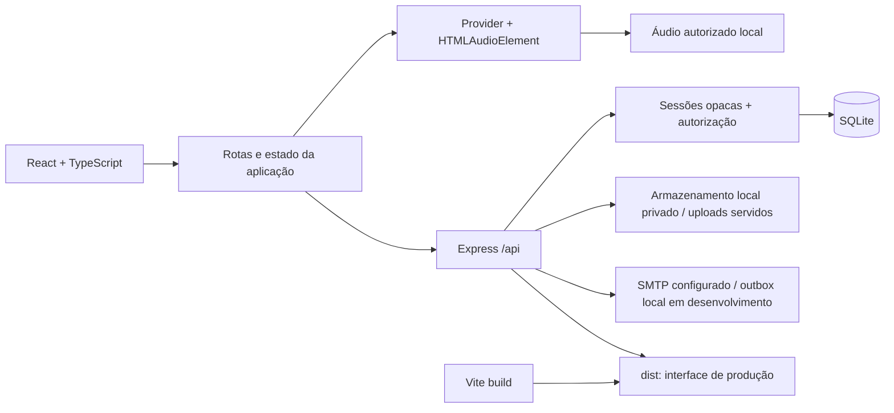

# Arquitetura do Spotfy

## Origem e objetivo

O repositório inicial tinha somente `README.md`. Esta implementação cria um aplicativo independente de música; não integra contas, catálogo, streams ou protocolos privados do Spotify. A referência pública permaneceu inacessível nesta sessão, conforme [ENGENHARIA_REVERSA.md](ENGENHARIA_REVERSA.md).

## Componentes

- **Frontend:** React, TypeScript e React Router. Componentes consultam uma API própria. O estado de sessão e biblioteca é compartilhado; o provider de áudio fica acima das páginas, evitando recriação durante a navegação.
- **Desenvolvimento:** Vite serve a interface e encaminha `/api` e `/uploads` para a API local. O backend escuta a porta 3001 por padrão.
- **Produção:** `npm run build` gera `dist`; `npm start` inicia o servidor da aplicação. Node 24.15 ou posterior dentro da linha 24 é exigido pelo manifesto; SQLite usa `node:sqlite`, sem serviço externo.
- **Contratos:** `shared/types.ts` define usuário público, artista, álbum, faixa, playlist, catálogo, biblioteca e preferências. Senhas, hashes e tokens de sessão não fazem parte desses contratos públicos.
- **Mídia:** `public/media` contém capas próprias e arquivos gerados pelo script de composição; o catálogo inicial está em `public/catalog.json`. Áudios WAV são gerados localmente e não versionados. Executar a geração na preparação de uma nova máquina.

## Organização de arquivos

| Caminho | Responsabilidade |
| --- | --- |
| `src/main.tsx` | Entrada React e providers |
| `src/App.tsx` e componentes de páginas | Layout, rotas e interação com catálogo/biblioteca |
| `src/api.ts` | Cliente HTTP, credenciais same-origin e mensagens de erro |
| `src/state.tsx` | Sessão, catálogo e biblioteca compartilhados |
| `src/Auth.tsx` | Formulários de autenticação e recuperação |
| `src/TrackList.tsx` | Faixas, reprodução e ações sobre biblioteca/playlists |
| `src/player/` | Elemento de áudio, fila, eventos, atalhos e controles |
| `server/app.ts` | Factory da API, validação, autenticação e autorização |
| `server/db.ts` | Schema SQLite, seed, hashes e consultas |
| `server/index.ts` | Inicialização do processo HTTP |
| `server/create-admin.ts` | Criação explícita do primeiro administrador |
| `shared/types.ts` | Contratos públicos do aplicativo |
| `scripts/generate_media.py` | Composição e renderização de áudio original |
| `tests/` | Testes de API, segurança, player e navegador |
| `data/` | Banco, uploads e outbox; conteúdo local ignorado pelo Git |
| `docs/evidence/` | Evidências de auditoria e validação sem credenciais |

Os nomes de arquivos finais devem ser conferidos com a árvore publicada; as responsabilidades descritas são a referência conceitual.

## Banco e integridade

O banco padrão é `data/spotfy.sqlite`. A inicialização habilita `foreign_keys`, WAL e `busy_timeout`. O schema inicial usa criação aditiva e registra a versão 1 em `schema_migrations`. O seed só roda se não houver artistas; não apaga dados existentes. Alterações futuras de schema precisam de migrações versionadas, backup consistente de banco/WAL e teste de atualização.

| Entidade | Dados e relações |
| --- | --- |
| `users` | Identidade, e-mail único, hash de senha, papel user/admin |
| `sessions` | Hash SHA-256 do token opaco, usuário, expiração |
| `password_resets` | Hash de token de recuperação, usuário e expiração |
| `artists` | Nome, biografia e imagem |
| `albums` | Artista, título, capa e ano |
| `tracks` | Artista, álbum, título, mídia local, duração, categoria e licença |
| `playlists` | Dono opcional, nome, descrição, capa e visibilidade |
| `playlist_tracks` | Faixas e posições únicas dentro da playlist |
| `liked_tracks` | Relação usuário/faixa com data |
| `saved_albums` | Relação usuário/álbum |
| `follows` | Relação usuário/artista |
| `playback_preferences` | Volume, aleatório e repetição por usuário |
| `listening_history` | Eventos de audição por usuário e faixa |
| `media_assets` | Caminho, MIME, tamanho, licença e responsável pelo upload |
| `audit_logs` | Ator, ação, entidade, detalhe operacional e data |

As relações impedem referências órfãs. Exclusões usam `CASCADE`, `RESTRICT` ou `SET NULL` conforme a entidade; uma exclusão referenciada deve retornar erro útil, em vez de remover dependências implicitamente. Biblioteca e itens privados são sempre filtrados pela sessão autenticada. Ordem de playlist é atualizada em transação.

## API

Todas as respostas de falha devem ser JSON com `error`. O cliente não recebe stacks, comandos SQL ou hashes. Os testes finais documentam os códigos de resposta efetivamente verificados.

| Grupo | Rotas e responsabilidade |
| --- | --- |
| Saúde | `GET /api/health`: verifica conexão com o banco |
| Sessão | `GET /api/me`; `POST /api/auth/register`, `/login`, `/logout` |
| Perfil | `PATCH /api/me` |
| Recuperação | `POST /api/auth/forgot-password`, `/reset-password` |
| Catálogo | `GET /api/catalog?q=&offset=&limit=`: busca e paginação |
| Biblioteca | `GET /api/library`; `PUT`/`DELETE /api/library/tracks/:id`, `/albums/:id`, `/artists/:id` |
| Playlists | `POST /api/playlists`; `GET`/`PATCH`/`DELETE /api/playlists/:id` |
| Preferências | `GET`/`PUT /api/preferences` |
| Histórico | `GET`/`POST /api/history` |
| Administração | `/api/admin/*`: indicadores, usuários, auditoria, entidades e arquivos |

Rotas exatas do painel e payloads finais são definidos por `server/app.ts`; mudanças de contrato devem ser refletidas nos tipos e testes. O catálogo usa dados do banco, não uma lista fictícia mantida na tela.

## Autenticação, autorização e recuperação

Senhas recebem salt aleatório e scrypt. A verificação usa comparação temporal constante dos hashes de mesmo comprimento. O servidor emite um token aleatório; armazena apenas seu hash e envia o token por cookie `HttpOnly`, `SameSite=Lax`, com `Secure` no modo de produção por padrão.

Logout remove a sessão do banco. A sessão não é um booleano armazenado no navegador. O papel administrativo é verificado no servidor em cada operação protegida, inclusive quando o usuário tenta chamar a API diretamente.

O fluxo de recuperação responde genericamente para evitar revelar a existência de uma conta. Tokens têm prazo, são armazenados como hash e devem ser consumidos uma única vez. Ao redefinir a senha, as sessões anteriores são removidas. Em desenvolvimento, a mensagem pode ser registrada somente na outbox local do servidor; isso permite validar o fluxo sem publicar o token em JSON. Entrega em caixa externa requer SMTP e remetente válidos. Em produção, a ausência de SMTP é um limite operacional, não um envio bem-sucedido.

O primeiro administrador é criado explicitamente pelo operador via `npm run admin:create`, usando variáveis de ambiente. Não existe senha padrão nem promoção automática do primeiro cadastro público.

## Player

A fonte de verdade da reprodução é `HTMLAudioElement`: `playing`, `pause`, `waiting`, `error`, `timeupdate`, `loadedmetadata` e `ended` determinam o estado visível. O controle de progresso altera `currentTime`; volume e mute modificam propriedades reais. A fila e os modos de repetição/aleatório são estado da aplicação; nenhuma função depende de streams do Spotify.

O provider permanece montado entre rotas. Navegar não inicia outro áudio. Recarregar o documento pode restaurar preferências, mas o aplicativo respeita as políticas de autoplay do navegador. Um erro de mídia deve permanecer explícito e a escolha de outra faixa deve permitir recuperação.

Preferências de visitante podem ficar no armazenamento local. Para usuário autenticado, a API oferece persistência no banco. Estado local não concede acesso nem substitui autenticação no servidor.

## Segurança e limites operacionais

- Zod valida entradas, tamanhos e formatos; SQL utiliza parâmetros para valores.
- Mutação via navegador valida `Origin`/contexto cross-site; cookies não são expostos ao JavaScript.
- Helmet aplica headers; limites de requisição e autenticação reduzem abuso básico.
- Uploads têm limites e validação; mídia executável não deve ser servida como código. URLs de catálogo apontam para caminhos locais autorizados.
- Configuração SMTP e credenciais de bootstrap ficam somente no processo do servidor; banco, mensagens e `.env` são ignorados pelo Git.
- O aplicativo armazena dados pessoais e mídia no disco local. Uso público exige HTTPS, política de backup/restauração, retenção, monitoramento e revisão de capacidade.
- SQLite e um processo de API atendem a este escopo. Escala horizontal exige coordenação e armazenamento compartilhado; não é uma capacidade demonstrada aqui.

## Configuração

| Variável | Uso | Sensível |
| --- | --- | --- |
| `NODE_ENV` | Desenvolvimento ou produção | Não |
| `PORT` | Porta da API | Não |
| `DATABASE_PATH` | Caminho do banco local | Não |
| `APP_ORIGIN` | Origem canônica e URL de recuperação | Não |
| `COOKIE_SECURE` | Padrão seguro em produção; `false` somente em teste HTTP local explícito | Não |
| `SMTP_HOST`, `SMTP_PORT`, `SMTP_SECURE` | Transporte de e-mail | Não |
| `SMTP_USER`, `SMTP_PASSWORD` | Autenticação SMTP | Sim |
| `SMTP_FROM` | Remetente autorizado | Não |
| `ADMIN_EMAIL`, `ADMIN_PASSWORD`, `ADMIN_NAME` | Bootstrap administrativo explícito | Senha: sim |

Consultar o `.env.example` e o código publicados para os nomes finais. Não incluir valores reais no frontend, commits, screenshots ou relatório.

## Validação e continuidade

Comandos previstos: `npm run typecheck`, `npm run lint`, `npm run build`, `npm test`, `npm run test:e2e`. Resultados executados estão em [RELATORIO_TESTES.md](RELATORIO_TESTES.md), e o estado de implementação/publicação em [CONTINUIDADE_CODEX.md](CONTINUIDADE_CODEX.md).
